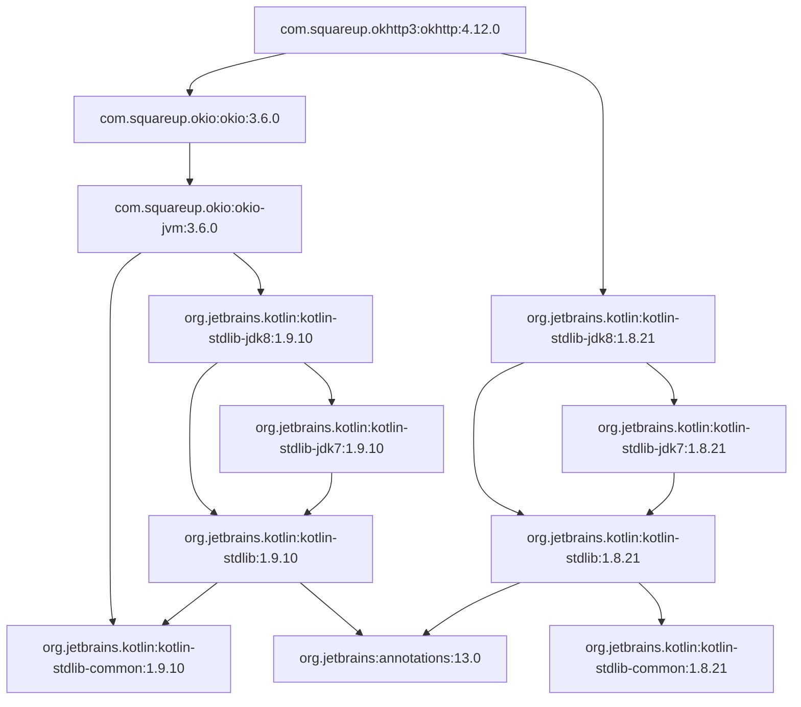
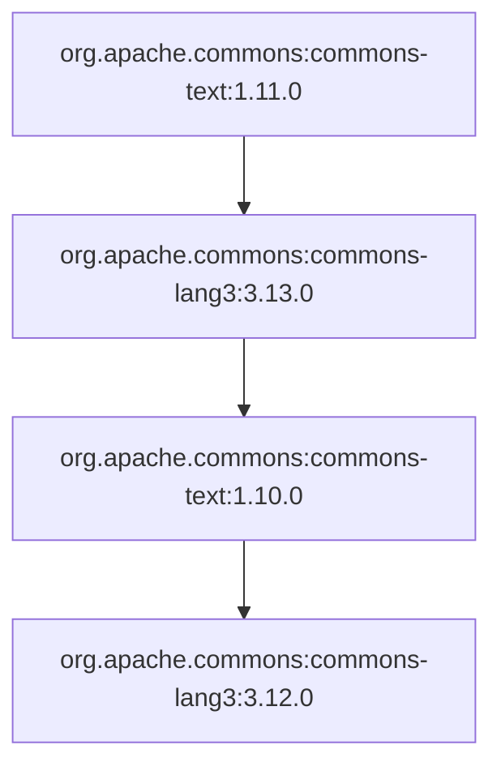

# Визуализатор графа зависимостей (Maven)

Вариант 5. CLI-программа на Python для анализа и визуализации графа
зависимостей пакетов Maven. Готовые менеджеры пакетов и библиотеки
для получения зависимостей не используются.

## Этап 1. Параметры командной строки

| Опция | Описание |
|---|---|
| `--package` | имя анализируемого пакета (обязательно). Обычный режим: `группа:название:версия`, тестовый режим: большие латинские буквы (`A`) |
| `--repo` | URL репозитория или путь к файлу тестового репозитория (обязательно) |
| `--test-mode` | режим работы с тестовым репозиторием (флаг) |
| `--max-depth` | максимальная глубина анализа, от 1 до 100 (по умолчанию 3) |
| `--filter` | подстрока для фильтрации пакетов (по умолчанию пусто) |

На этапе 1 программа выводила все параметры в формате `ключ = значение`.
При неверных параметрах выводится сообщение об ошибке.

## Этап 2. Сбор данных

Пакеты задаются в формате Maven: `группа:название:версия`.
Программа:

1. собирает адрес POM-файла пакета:
   `репозиторий/группа(точки→слэши)/название/версия/название-версия.pom`;
2. скачивает его стандартным модулем `urllib.request`;
3. разбирает XML стандартным модулем `xml.etree.ElementTree` и берёт
   все `<dependency>` из раздела `<dependencies>` (зависимости со
   `<scope>test</scope>` пропускаются);
4. выводит прямые зависимости по одной на строке (только на этапе 2).

Менеджеры пакетов и сторонние библиотеки не используются.

Пример:

```
python src\main.py --package com.squareup.okhttp3:okhttp:4.12.0 --repo https://repo1.maven.org/maven2
Прямые зависимости пакета com.squareup.okhttp3:okhttp:4.12.0:
  com.squareup.okio:okio:3.6.0
  org.jetbrains.kotlin:kotlin-stdlib-jdk8:1.8.21
```

Если пакет не найден, выводится ошибка:

```
python src\main.py --package com.squareup.okhttp3:okhttp:999 --repo https://repo1.maven.org/maven2
Предупреждение: не удалось скачать ... (HTTP Error 404: Not Found)
```

## Этап 3. Граф зависимостей

Программа строит полный граф зависимостей (с учётом транзитивности):
зависимости пакета, зависимости этих зависимостей и так далее.

- **DFS с рекурсией.** Функция `dfs` скачивает прямые зависимости
  пакета, записывает их в граф и вызывает саму себя для каждой
  зависимости. Уже обойдённые пакеты повторно не обрабатываются.
- **Максимальная глубина** (`--max-depth`). Начальный пакет имеет
  глубину 0, его прямые зависимости — 1 и т.д. Пакеты на глубине
  `max-depth` не раскрываются.
- **Фильтр** (`--filter`). Пакеты, имя которых содержит подстроку,
  не попадают в граф, и их зависимости не анализируются.
- **Циклы.** Во время обхода хранится текущий путь `path`. Если пакет
  уже есть в пути, выводится сообщение `Найден цикл: ...`, и обход
  этой ветки прекращается, поэтому программа не зацикливается.
- **Тестовый режим** (`--test-mode`). Вместо URL указывается путь к
  файлу, где пакеты названы большими латинскими буквами:

```
A: B C
B: D
C: D
D:
```

Каждая строка: `пакет: зависимости через пробел`.

На этапах 3–4 вывод был списком строк `пакет -> зависимости`,
с этапа 5 граф выводится на языке Mermaid.

### Тестовые файлы

| Файл | Что демонстрирует |
|---|---|
| `tests/test_repo.txt` | общая зависимость (B и C зависят от D) |
| `tests/cycle.txt` | цикл A → B → C → A |
| `tests/deep.txt` | длинная цепочка для проверки глубины |
| `tests/big.txt` | большой граф с циклом A → D → G → A, фильтр |
| `tests/bad.txt` | ошибка формата файла |

### Примеры

```
python src\main.py --package A --repo tests\test_repo.txt --test-mode
A -> B, C
B -> D
D -> нет зависимостей
C -> D

python src\main.py --package A --repo tests\cycle.txt --test-mode
Найден цикл: A -> B -> C -> A
A -> B
B -> C
C -> A

python src\main.py --package A --repo tests\deep.txt --test-mode --max-depth 2
A -> B
B -> C

python src\main.py --package A --repo tests\big.txt --test-mode --max-depth 10 --filter C
Найден цикл: A -> D -> G -> A
A -> B, D
B -> E
E -> H
H -> нет зависимостей
D -> G
G -> A

python src\main.py --package A --repo tests\bad.txt --test-mode
Ошибка: неверная строка в тестовом файле: B C

python src\main.py --package com.squareup.okhttp3:okhttp:4.12.0 --repo https://repo1.maven.org/maven2 --max-depth 3
```

## Этап 4. Обратные зависимости

> Режим `--reverse` требовался только для этапа 4 и удалён на этапе 5.
> Его код есть в истории коммитов (коммит `feat(graph): add reverse dependencies mode`).

Опция `--reverse` выводит обратные зависимости пакета — все пакеты,
которые зависят от него (напрямую или через другие пакеты).

Используется тот же алгоритм DFS, что и на этапе 3. Отличие только в
функции `load_dependencies`: в режиме `--reverse` она возвращает не
зависимости пакета, а пакеты, которые от него зависят (`find_parents`).
Поэтому глубина, фильтр и обработка циклов работают так же.

Режим работает только вместе с `--test-mode`: в POM-файле Maven указано,
от чего зависит пакет, но не указано, кто зависит от него.

### Примеры

```
python src\main.py --package D --repo tests\test_repo.txt --test-mode --reverse
От пакета D зависят: B, C, A

python src\main.py --package A --repo tests\test_repo.txt --test-mode --reverse
От пакета A никто не зависит

python src\main.py --package E --repo tests\deep.txt --test-mode --reverse --max-depth 10
От пакета E зависят: D, C, B, A

python src\main.py --package E --repo tests\deep.txt --test-mode --reverse --max-depth 2
От пакета E зависят: D, C

python src\main.py --package A --repo tests\cycle.txt --test-mode --reverse
Найден цикл: A -> C -> B -> A
От пакета A зависят: C, B

python src\main.py --package H --repo tests\big.txt --test-mode --reverse --max-depth 10
Найден цикл: H -> E -> B -> A -> G -> D -> A
От пакета H зависят: E, B, C, A, G, D

python src\main.py --package H --repo tests\big.txt --test-mode --reverse --max-depth 10 --filter B
Найден цикл: H -> E -> C -> A -> G -> D -> A
От пакета H зависят: E, C, A, G, D

python src\main.py --package a:b:c --repo http://x --reverse
Ошибка: обратные зависимости работают только с --test-mode
```

## Этап 5. Визуализация

### Текст на языке Mermaid

Функция `to_mermaid` превращает граф в текст на языке диаграмм
[Mermaid](https://mermaid.js.org): сначала объявляются все узлы, затем
стрелки `зависящий --> зависимость`. В Mermaid имя узла может содержать
только буквы, цифры и `_`, поэтому функция `node_id` заменяет остальные
символы на `_`, а настоящее имя пакета выводится как подпись узла.

```
python src\main.py --package A --repo tests\big.txt --test-mode --max-depth 10
```

```
Найден цикл: A -> D -> G -> A
graph TD
    A["A"]
    B["B"]
    C["C"]
    D["D"]
    E["E"]
    H["H"]
    F["F"]
    G["G"]
    A --> B
    A --> C
    A --> D
    B --> E
    E --> H
    C --> E
    C --> F
    D --> G
    G --> A
Изображение графа сохранено в graph.html
```

### Изображение графа

Функция `show_image` сохраняет Mermaid-текст в файл `graph.html` и
открывает его в браузере (стандартный модуль `webbrowser`). Страница
подключает библиотеку отрисовки Mermaid, и в браузере появляется
картинка графа. Файл `graph.html` создаётся заново при каждом запуске
и добавлен в `.gitignore`.

Тот же текст можно вставить на сайт <https://mermaid.live>.

### Примеры для трёх пакетов

Запуск (глубина 10):

```
python src\main.py --package com.squareup.okhttp3:okhttp:4.12.0 --repo https://repo1.maven.org/maven2 --max-depth 10
python src\main.py --package com.google.guava:guava:33.0.0-jre --repo https://repo1.maven.org/maven2 --max-depth 10
python src\main.py --package org.apache.commons:commons-text:1.11.0 --repo https://repo1.maven.org/maven2 --max-depth 10
```

GitHub отображает блоки Mermaid ниже как картинки.

#### 1. okhttp 4.12.0



#### 2. guava 33.0.0-jre

```mermaid
graph TD
    com_google_guava_guava_33_0_0_jre["com.google.guava:guava:33.0.0-jre"]
    com_google_guava_failureaccess_1_0_2["com.google.guava:failureaccess:1.0.2"]
    com_google_guava_listenablefuture_9999_0_empty_to_avoid_conflict_with_guava["com.google.guava:listenablefuture:9999.0-empty-to-avoid-conflict-with-guava"]
    com_google_code_findbugs_jsr305__["com.google.code.findbugs:jsr305:?"]
    org_checkerframework_checker_qual__["org.checkerframework:checker-qual:?"]
    com_google_errorprone_error_prone_annotations__["com.google.errorprone:error_prone_annotations:?"]
    com_google_j2objc_j2objc_annotations__["com.google.j2objc:j2objc-annotations:?"]
    com_google_guava_guava_33_0_0_jre --> com_google_guava_failureaccess_1_0_2
    com_google_guava_guava_33_0_0_jre --> com_google_guava_listenablefuture_9999_0_empty_to_avoid_conflict_with_guava
    com_google_guava_guava_33_0_0_jre --> com_google_code_findbugs_jsr305__
    com_google_guava_guava_33_0_0_jre --> org_checkerframework_checker_qual__
    com_google_guava_guava_33_0_0_jre --> com_google_errorprone_error_prone_annotations__
    com_google_guava_guava_33_0_0_jre --> com_google_j2objc_j2objc_annotations__
```



#### 3. commons-text 1.11.0



### Сравнение со штатным инструментом Maven

Штатный инструмент Maven для просмотра зависимостей —
`mvn dependency:tree`. Для проверки нужно создать `pom.xml` с одной
зависимостью и выполнить команду в его папке:

```xml
<project xmlns="http://maven.apache.org/POM/4.0.0">
  <modelVersion>4.0.0</modelVersion>
  <groupId>demo</groupId>
  <artifactId>demo</artifactId>
  <version>1.0</version>
  <dependencies>
    <dependency>
      <groupId>com.squareup.okhttp3</groupId>
      <artifactId>okhttp</artifactId>
      <version>4.12.0</version>
    </dependency>
  </dependencies>
</project>
```

```
mvn dependency:tree
```

Ниже — дерево, которое Maven строит по своим правилам из тех же
POM-файлов (родительские POM и правило «ближайший побеждает»).

**okhttp 4.12.0**

```
com.squareup.okhttp3:okhttp:jar:4.12.0
+- com.squareup.okio:okio:jar:3.6.0
|  \- com.squareup.okio:okio-jvm:jar:3.6.0
|     \- org.jetbrains.kotlin:kotlin-stdlib-common:jar:1.9.10
\- org.jetbrains.kotlin:kotlin-stdlib-jdk8:jar:1.8.21
   +- org.jetbrains.kotlin:kotlin-stdlib:jar:1.8.21
   |  \- org.jetbrains:annotations:jar:13.0
   \- org.jetbrains.kotlin:kotlin-stdlib-jdk7:jar:1.8.21
```

**guava 33.0.0-jre**

```
com.google.guava:guava:jar:33.0.0-jre
+- com.google.guava:failureaccess:jar:1.0.2
+- com.google.guava:listenablefuture:jar:9999.0-empty-to-avoid-conflict-with-guava
+- com.google.code.findbugs:jsr305:jar:3.0.2
+- org.checkerframework:checker-qual:jar:3.41.0
+- com.google.errorprone:error_prone_annotations:jar:2.23.0
\- com.google.j2objc:j2objc-annotations:jar:2.8
```

**commons-text 1.11.0**

```
org.apache.commons:commons-text:jar:1.11.0
\- org.apache.commons:commons-lang3:jar:3.13.0
```

### Расхождения и их причины

| Пакет | Наш инструмент | Maven | Причина |
|---|---|---|---|
| okhttp | две версии Kotlin: `1.8.21` и `1.9.10` | одна версия каждого пакета | Maven разрешает конфликты версий: из нескольких версий одного пакета оставляет ту, что ближе к корню («nearest wins»), остальные отбрасывает. Наш инструмент показывает все версии как разные пакеты. |
| guava | 4 зависимости с версией `?`, дальше обход не идёт | версии `3.0.2`, `3.41.0`, `2.23.0`, `2.8` | Версии не записаны в POM guava, они берутся из родительского POM `guava-parent` (раздел `<dependencyManagement>` и `<properties>`). Наш инструмент не читает родительские POM. |
| commons-text | лишние `commons-text:1.10.0` и `commons-lang3:3.12.0` | только `commons-lang3:3.13.0` | В POM `commons-lang3` зависимость от `commons-text` имеет `<scope>provided</scope>`. Такие зависимости Maven не передаёт дальше (они не транзитивны). Наш инструмент пропускает только `test`. |

Кроме того, наш инструмент не подставляет переменные вида
`${jackson.version.core}` (например, в `jackson-databind`), не учитывает
`<optional>` и `<exclusions>`. Это упрощения: по заданию нельзя
использовать готовые средства получения зависимостей.

## Запуск

```
run.bat --package org.slf4j:slf4j-api:2.0.9 --repo https://repo1.maven.org/maven2 --max-depth 2 --filter test
```

или

```
python src\main.py --package A --repo tests\test_repo.txt --test-mode
```

## Примеры ошибок

```
python src\main.py --package slf4j --repo https://x
Ошибка: имя пакета Maven пишется так: группа:название:версия

python src\main.py --package a:b --repo ftp://x
Ошибка: URL должен начинаться с http:// или https://

python src\main.py --package A --repo nofile.txt --test-mode
Ошибка: файл тестового репозитория не найден: nofile.txt

python src\main.py --package a:b --repo http://x --max-depth 0
Ошибка: глубина должна быть от 1 до 100
```
